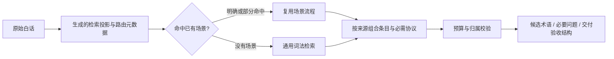

<div align="center">

# Feeling to Jargon

### 你说感觉，Feeling to Jargon 帮你补全专业术语。

<p>
  
  
  
  
  <a href="LICENSE"></a>
</p>

<p>
  <a href="#快速开始">快速开始</a> ·
  <a href="#渐进式索引">渐进式索引</a> ·
  <a href="#按需查询">按需查询</a> ·
  <a href="#添加新领域">添加新领域</a>
</p>

</div>

## 它能做什么

你知道自己想要什么，但不知道怎么说得专业？Feeling to Jargon 会识别需求所属领域，按需加载术语，把“有质感”“稳定”“高级”“专业一点”等模糊表达扩展成更具体、更可执行的提示词。

Feeling to Jargon 不替你决定方向。它把专业选项翻译成容易理解的语言，再让你选择真正重要的取舍。

| 你说 | Feeling to Jargon 帮你补全 |
|---|---|
| 做一个有质感的网站 | 信息密度、字体层级、对比度、留白节奏、组件一致性 |
| 做一个稳定的大型后端 | 高可用、流量模型、水平扩展、幂等、熔断、可观测性 |
| 做一个电影感的视频 | 景别、光线、构图、色调、运动、画幅比例、声音 |
| 做一个高级感 Dashboard | 底色、强调色、布局层级、材质、内容主角 |

## 快速开始

推荐使用 `npx`，它适用于 Claude Code、Cursor、Codex、OpenCode 等 Agent 工具：

```bash
npx skills add https://github.com/konglong87/feeling-to-jargon
```

指定平台或只安装本 Skill：

```bash
npx skills add https://github.com/konglong87/feeling-to-jargon --skill feeling-to-jargon --agent claude-code
npx skills add https://github.com/konglong87/feeling-to-jargon --skill feeling-to-jargon --agent cursor
npx skills add https://github.com/konglong87/feeling-to-jargon --skill feeling-to-jargon --agent codex
npx skills add https://github.com/konglong87/feeling-to-jargon --skill feeling-to-jargon --agent opencode
```

查看可用 Skill、全局安装：

```bash
npx skills add https://github.com/konglong87/feeling-to-jargon --list
npx skills add https://github.com/konglong87/feeling-to-jargon -g
```

安装后可以直接说：

```text
删除列表项，5 秒内撤销并支持键盘；撤销时要沿原路径回来。
```

## 安装后如何调用

在任意消费项目中，以安装的 `SKILL.md` 所在目录作为 `SKILL_DIR`：

```bash
python3 <SKILL_DIR>/scripts/query.py "我想做一个有质感的网站" --format agent
```

这是自包含的只读入口，不需要另找源码仓库，也不依赖消费项目的当前工作目录。正文仍在源码叶子中唯一维护；随包运行资源由构建器生成并校验，无需联网、解包写盘或额外 Python 依赖（需要 Python 3.9+）。

`agent` 输出保留完整知识正文、必需依赖、场景流程与范围约束，只压缩重复解释和诊断。需要调试时可切回兼容的 `--format full`。原话未命中时，宿主可按 Skill 的有限 catalog / 证据回填协议理解改写；这与原始 CLI 自带语义能力是两回事。

## 渐进式索引

**知识组织、检索路由与知识组合分别负责“存在哪里”“找到什么”“怎样一起完成任务”。不以分类更细或命中更多叶子作为目标。**

五级结构继续负责归属和引用：`根领域 → 子域 → 意图 → 叶子 → 条目`。CLI 并不是依次遍历这棵树；它的实际顺序是：



`aliases / plain_language / when_to_use` 及条目内少量 `retrieval` 规则是生成检索投影的来源。正文保留在叶子文件；多个入口引用稳定 ID，不手工复制正文。`related` 是松散相关信息，不是必须全部加载的依赖。

CLI 使用有限词法与组合证据，不是向量或 LLM 语义检索。分数仅供排序，历史 `high_confidence_*` 配置名不表示经过校准的置信概率。索引读取发生在程序内部，**不把完整索引放进 LLM 上下文**；快路径仍会检查生成的条目投影，而非零检索。

默认最多 3 个子域、每子域 3 个意图、8 个叶子、每叶子 30 条，另有 **24,000 字符的知识正文预算**。该预算按 `matches + dependencies` 的紧凑 JSON 计数，不是 token 或整个响应上限。解释、交付和 trace 是额外开销，评测同时统计完整输出字符数。必需组合放不下时返回 `needs_staging`，不截掉性能、降级或减少动态约束。CLI 数量/字符选项只能收紧默认预算。

规模保持 **19 个领域、105 个叶子**，新增的是生成的条目检索投影和 **4 个场景流程**，不是更多分类。

## 场景快路径与交付

| 场景 | 固定流程与边界 | 不替用户决定 |
| --- | --- | --- |
| 后端质量目标 | 有证据的质量属性 → 必要指标澄清 → 约束与验证 | 稳定不自动等于并发、扩展或幂等；总用户数不等于峰值并发 |
| 视觉感觉 | 感觉 → 结构/设计令牌候选 → 确认方向 → 截图与可读性验收 | 不默认暗色、玻璃、渐变、栅格或色值 |
| 可撤销删除 | 时序/窗口 → 可访问性和反向恢复依赖 → 到期/焦点验收 | 不把原知识中的示例时间直接当本次答案 |
| Dashboard 联动 | 已有变体 → 共享协议 → 状态与 token → 联动验收 | 不叠加互斥主布局，不复制整套风格库 |

配方只引用已有条目、`contract_ref` 与 `composition`。部分命中保留已确定内容，只询问改变方案的信息；无场景时回退到通用检索，无知识时明确覆盖不足。候选输出区分 `explicit` 与 `suggestion`，没有参数依据时不替用户填数值。

[架构与验收方案](docs/evaluation/architecture.md) · [CLI/宿主调用契约](docs/routing-contract.md) · [初版真实输入评测](docs/evaluation/report.md) · [真实宿主复审与成本](docs/evaluation/review/report.md)

## 按需查询

在仓库根目录运行：

```bash
python3 scripts/query-index.py "我想做一个大型的后端，给很多人用，要稳定"
python3 scripts/query-index.py "我想做一个有质感的网站"
python3 scripts/query-index.py "删除后可以反悔，而且键盘也能操作"
python3 scripts/query-index.py "设计一个不模板化的 AI 数据后台"
python3 scripts/query-index.py "把这个角色做成毛绒玩偶和周边"
python3 scripts/query-index.py "GPUIX 能不能跑移动端？"
```

查询结果会输出：

- 命中的子域和叶子包
- 实际加载的文件路径
- 匹配的术语/技巧/模板条目
- `provider-specific` 和 `do_not_generalize` 等边界标记
- 本次是否触发网络搜索（默认不搜索）
- 命中表达、来源与明确需求/建议方向：`explanations`
- 共享协议、必需依赖、互斥与分阶段计划：`dependencies / composition`
- 必要问题、覆盖不足和场景交付结构：`clarifications / coverage / delivery`
- 内部读取、输出正文量、路由评分次数与耗时：`trace`

`ready` 仅代表本次知识组合和所需信息已就绪，不代表产品已经实现或通过验收。供应商事实未经核验时返回 `needs_verification`。原始 CLI、宿主 LLM 理解、实际产品验收是三个不同边界。

## 内容分层

### UI/UX

覆盖撤销条、FLIP 反向归位、跟随/阈值/吸附、速度继承、可中断动画、12 种基础动效、14 种连续交互和 10 种高级手势模式、Dashboard 视觉配方、5 种视觉效果、GSAP 适配边界、8 个可投喂给 AI 的组件描述，以及键盘、读屏和 `prefers-reduced-motion` 约束。

连续交互包把搜索框、FAB 面板、提交状态、图标变形、标签指示条、步进器、列表展开、FLIP 布局切换、滚动收起和全屏揭示拆成独立叶子；本轮新增勾选联动、叠卡展开、吸附卡加画线和圆形扩散转场，并把惯性滚轮归入高级手势交互。已有组件索引继续扩展为撕线弹出面板、保存按钮进度环和卡片层叠轮播；只有没有合适既有边界的吸边悬浮球新建叶子。每个模式都用状态机、动画序列、空间锚点、可测参数、可访问性和验收标准描述，把“细腻”“顺滑”“有质感”等感觉翻译成可以实现和检查的术语。高级手势包还覆盖按住确认、旋钮、前后对比、弧形菜单、滑动确认、长按预览、拖拽吸入、分段进度和透视轮播。

视觉效果包会把实现参数和性能边界一起加载：液态玻璃栏、封面取色氛围光、景深分层滚动、圆柱卷收列表、液滴粘连拖拽。每条记录同时提供性能预算、降级方案、移动端处理和减少动态策略，避免只复制视觉效果而忽略运行成本。

GSAP 适配包只在用户指定 GSAP 或项目已经使用 GSAP 时加载，覆盖 Core、Timeline、ScrollTrigger、Plugins、React 生命周期、性能和框架生命周期。它保留 provider-specific 与版本核验边界，不把工具 API 当作通用浏览器事实。

设计系统包提供 Light/Dark 活样式预览规范：色板、排印、按钮/输入框/卡片状态、token 到页面效果的映射和截图验收清单。外部预览站只作为待核验参考，不写入运行时事实。

### AIGC

保留基础 IP 和七个场景模板，并将角色一致性、图像提示词、视频镜头、材质、构图、运动、负面约束和工具适配拆成独立子域。一次请求只读取需要的模块。

### 后端与软件工程

将后端架构、高可用、高并发、扩展策略、可观测性、幂等、前端平台和跨平台渲染分开索引，避免把“稳定”“高并发”“高扩展”当成没有边界的口号。

### 平台研究

GPUIX 和 ThreeUI 内容被标记为 `platform-research`、`provider-specific`。未填写 `verified_at` 前只能当作待核验研究线索，不能泛化成所有 GPU UI 框架的事实。

## 项目结构

```text
index/
├── root.json                 # 根领域与加载上限
├── packages.json             # 兼容旧版领域术语包入口
├── domains/                  # 第二级：专业子域
├── intents/                  # 第三级：用户意图
├── leaves.json               # 第四级：叶子包清单
└── runtime.json              # 热路径运行时路由索引

terms/
├── interaction/              # 动效、撤销、跟手、阈值、吸附
├── dashboard/                # Dashboard 视觉方向
├── component-design/         # AI 可生成组件描述
├── visual-effects/            # 玻璃、光晕、景深和液态交互
├── animation-tool-adapter/   # GSAP 等动画工具适配
├── design-system/            # Light/Dark 活样式预览规范
├── character-ip/             # AIGC 角色一致性
├── platform-research/        # 平台专属研究
├── software-engineering/     # 软件架构叶子包
└── workplace/                # 职场表达与协作

templates/
├── aigc/                     # 基础 IP 与七个场景模板
├── dashboard/                # Dashboard 审美 Skill 模板

skills/feeling-to-jargon/SKILL.md        # Agent 加载规则
scripts/query-index.py        # 渐进式查询器
scripts/validate-index.py     # 索引一致性校验
scripts/bootstrap-progressive-content.py # 可重复生成内容与索引
```

## Dashboard：三层规范，不增加索引

术语定义信息结构 → UI 定义视觉与栅格 → Agent 定义交互状态机。布局变体合并到现有 `layout-patterns` 叶子，共用 `templates/dashboard/dashboard-style-system.json`；不会为每种配色或业务场景创建新叶子。

| 同类条目 | 关键约束 | 来源状态 |
| --- | --- | --- |
| 多彩错列布局 | 日期只联动柱形与标签；容量圆点独立 | 原文已提供 |
| 工业分区布局 | 低库存 `st=2`；物料选中联动补货卡；计数由集合派生 | 原文已提供 |
| 中轴观测布局 | 队列、读数、星图和曲线共享目标与时间 | 原文已提供 |
| 玻璃点阵布局 | 月份与指标共享状态；点 8 月评分回到 8 月 | 原文已提供 |
| 暖色三栏布局 | 已知视觉可复用；房间联动与模式/单位同步保留为建议 | 视觉已提供，交互为建议 |

具体查询先在叶子内部排序，再应用 `--max-entries` 限额；未指定变体时只返回概览。同分路由不再因为条目合并而降权。

每条提供 `layout / termSkill / uiSkill / agentExec / state / tokens`，并区分原文信息与建议的状态建模。本轮按已有的 **5 种布局**完成素材整理，不设额外案例补齐项。各例参数仅在自身示例内有效；建议交互的具体业务规则仅在实际实现时确认。

```bash
python3 scripts/query-index.py "工业分区布局" --max-entries 1
python3 scripts/query-index.py "玻璃点阵月份指标联动"
```

## 添加新领域骨架 SOP

1. 在 `index/root.json` 增加根领域和 `subdomain_index`。
2. 新建 `index/domains/<domain_id>.json`，只放子域摘要和加载入口。
3. 为每个子域新建 `index/intents/<domain_id>/<subdomain_id>.json`，只放意图和叶子引用。
4. 在 `terms/<area>/` 增加独立叶子包；每个叶子只描述一个术语、模式、技巧或模板集合。
5. 在 `index/leaves.json` 登记叶子元数据，在 `index/runtime.json` 增加关键词路由。
6. 跑校验和端到端查询：

```bash
python3 scripts/build-skill.py # 源码/知识/调用契约改动后重建随包资源
python3 scripts/validate-index.py
python3 scripts/test-progressive-index.py # 包含 Dashboard 与真实白话/组合回归
python3 scripts/evaluate-user-outcomes.py # 重新测量；不覆盖修改前基线
python3 scripts/evaluate-review.py # 复审固定输入的完整/紧凑输出对比
python3 scripts/verify-host-review.py # 核对保留的真实宿主证据，不会重新调用模型
python3 scripts/query-index.py "一个真实用户请求"
```

7. 只提交公开、可复用、无密钥、无本机路径和无用户隐私的内容。

叶子 JSON 是可编辑的事实来源。运行 `scripts/bootstrap-progressive-content.py` 时，已有叶子会被读取并保留；只有缺失叶子会从内置骨架生成。确实需要用脚本内置内容覆盖已有叶子时，才显式使用：

```bash
python3 scripts/bootstrap-progressive-content.py --force
```

意图索引按 `index/intents/<domain_id>/<subdomain_id>.json` 命名，避免不同领域出现同名子域时互相覆盖。

## 卸载

```bash
npx skills list
npx skills remove feeling-to-jargon
npx skills remove feeling-to-jargon -g
npx skills remove feeling-to-jargon --agent cursor
```

若安装器参数发生变化，请以 `npx skills --help` 的当前提示为准。

## License

[MIT](LICENSE)
